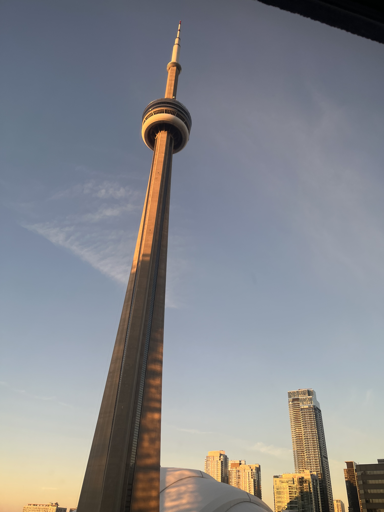
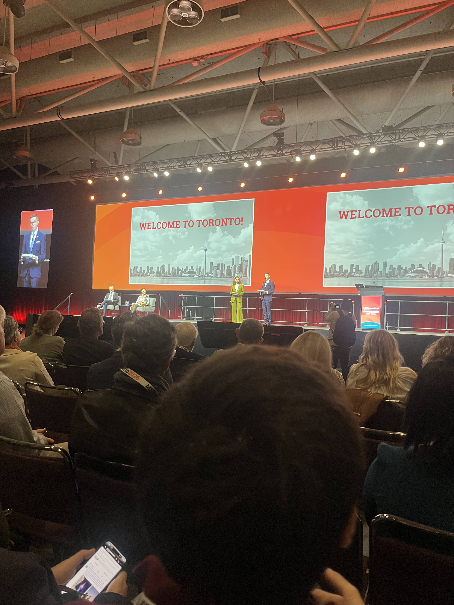
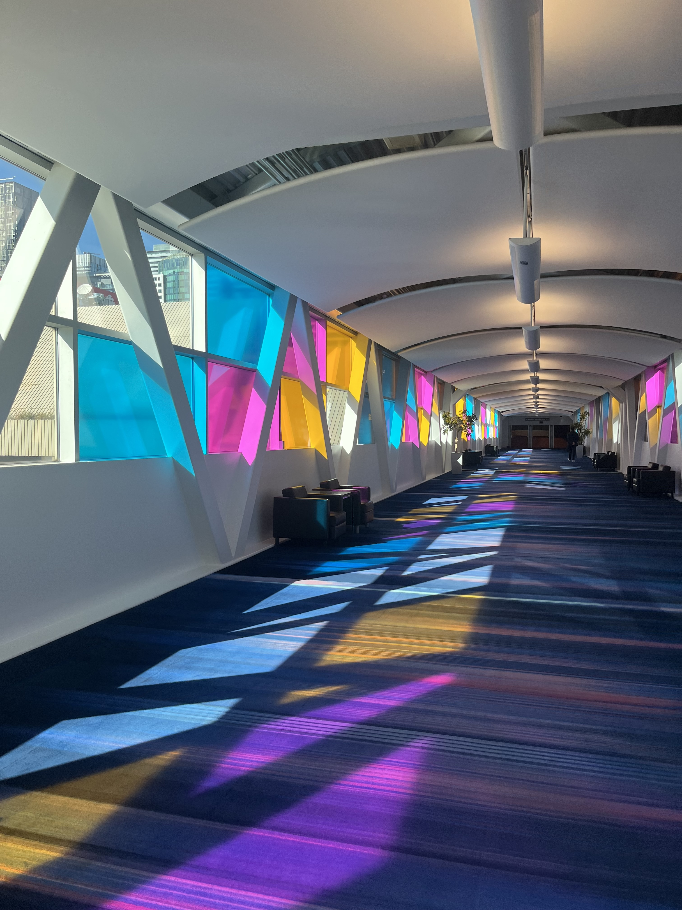
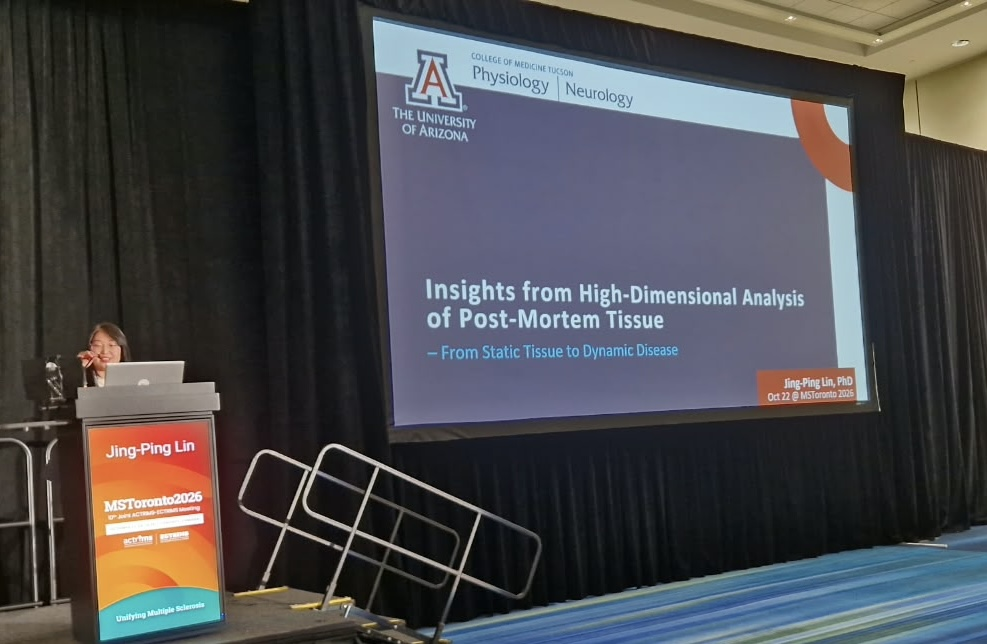

Toronto, Canada | October 19-23, 2026

<a href="https://mstoronto2026.org/">The Americas Committee for Treatment and Research in Multiple Sclerosis</a>

> So happy to reconnect with so many old friends and meet some new ones at #MSToronto2026, the 10th Joint ACTRIMS–ECTRIMS Global Meeting!
I’m honored to have been invited as faculty for the first time. Preparing for this talk gave me a chance to reflect on my journey to becoming a scientist. I’m immensely grateful to my mentors, who created space for me to learn and grow. I’m now committed to finding meaningful ways to do the same for mine. Daniel Reich Roman Giger Shyh-Jye Lee

